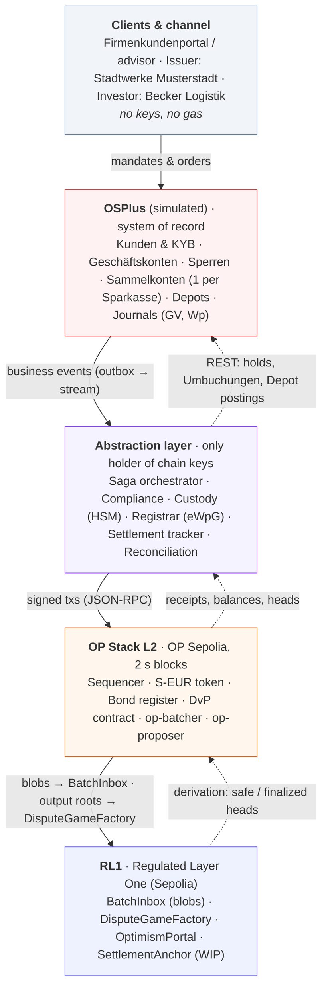
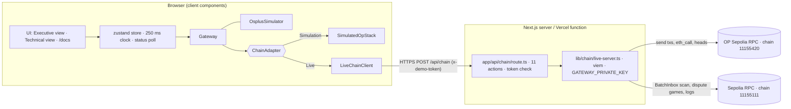

# Architecture

## The five layers

Each layer talks only to its neighbours, and only the abstraction layer holds chain keys. Clients never see a wallet, a key or gas.

Solid arrows carry instructions down the stack, dotted arrows carry results and status back up.

The abstraction layer is the only place that translates between banking concepts (IBAN, Buchung, EndToEndId, Depot) and ledger concepts (address, transaction, `bytes32` reference, register balance).

## Layer responsibilities

| Layer | Owns | Does not do | Code |
| --- | --- | --- | --- |
| Clients | Initiate onboarding, issuance, tokenization, trades, redemptions through existing channels | Hold keys, pay gas, talk to the chain | UI buttons |
| OSPlus | Client master data, KYB status, euro accounts and balances, holds, booking journal with GV codes, Depots and securities journal, one omnibus account per Sparkasse | Know anything about blockchains | `lib/osplus/simulator.ts` |
| Gateway | Translation both ways, compliance, custody, idempotent references, sagas with compensation, registrar role, interbank rebalancing, settlement tracking, reconciliation | Depend on a specific chain (it only uses the `ChainAdapter` interface) | `lib/gateway/gateway.ts` |
| L2 | Settlement ledger for S-EUR and bonds, permissioning, atomic DvP, on-chain coupon calculation | Hold euros outside its tokens, know client identities | `contracts/*.sol`, `lib/chain/*` |
| RL1 | Data availability for L2 batches, settlement finality, state commitments, bridge (portal) | Execute the business logic | read by `lib/chain/live-server.ts` |

## Interfaces between the layers

| From → To | Interface | Content |
| --- | --- | --- |
| Clients → OSPlus / gateway | Portal, mandates | Issuance mandate, tokenization order, settlement instruction, redemption order |
| OSPlus → gateway | Events (outbox → stream) | `osplus.kunden.v1.KundeAngelegt`, order forwarding |
| Gateway → OSPlus | REST | Holds, Umbuchungen, Depot postings, reconciliation result |
| Gateway → L2 | JSON-RPC | `eth_sendRawTransaction`, `eth_getTransactionReceipt`, `eth_call`, block tags |
| L2 → RL1 | Rollup protocol | op-batcher blob transactions to the BatchInbox, op-proposer output roots in dispute games |
| RL1 → L2 | Derivation | L2 `safe` and `finalized` heads follow RL1 inclusion and finality |

The REST and event names are modelled interfaces shown in the trace log. They are not running HTTP services. See [Business lifecycle](lifecycle.md#modelled-interfaces).

## Runtime topology

The logical layers map onto a browser and one server route. Most of the system runs in the browser. In Live mode only the signing key, transaction submission and chain reads sit on the server.

The seam is `ChainAdapter` (`lib/chain/types.ts`). The gateway, the OSPlus model and the UI are identical in both modes. Only the adapter changes: an in-memory rollup, or a thin client that forwards each call to `/api/chain`, where the key lives.

> **Architectural consequence.** Because compliance checks, limits and saga logic run in the browser, the server route signs whatever action it is sent, provided the caller has the access token (or none is configured). This is acceptable for a demo and is the first thing to change beyond one. See [Limitations](limitations.md).

## Deployment variants

| Variant | Modes | Where the gateway key lives |
| --- | --- | --- |
| `pnpm dev` / `pnpm start` | Simulation + Live | `.env.local` on the machine |
| Vercel | Simulation + Live | Vercel environment variable |
| GitHub Pages (static export) | Simulation only | nowhere: no server, `/api/chain` is not built |
