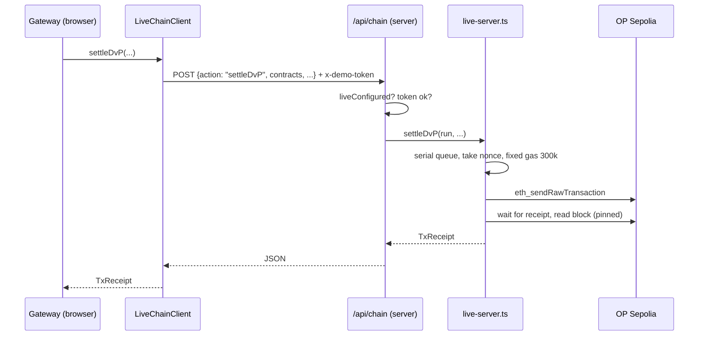

# Chain adapters & API

## The `ChainAdapter` interface

`lib/chain/types.ts` defines the seam between the abstraction layer and the ledger. The gateway only ever talks to this interface, so the same lifecycle runs against the in-browser simulation or a live OP Stack chain.

```ts
interface ChainAdapter {
  kind: "simulated" | "live";
  /** Deploy the run's contracts: cash token, bond register, DvP contract (+ wiring). */
  init(): Promise<{ contracts: Contracts; txs: { label: string; hash: Hex; address?: Hex }[] }>;
  provisionWallet(id: string): Promise<Hex>;
  onboard(account: Hex, ref: string): Promise<TxReceipt>;
  issueBond(issuer: Hex, units: number, ref: string): Promise<TxReceipt>;
  mintCash(to: Hex, cents: number, ref: string): Promise<TxReceipt>;
  burnCash(from: Hex, cents: number, ref: string): Promise<TxReceipt>;
  /** With allowRevert a failing trade resolves with status "reverted" instead of throwing. */
  settleDvP(tradeId: string, seller: Hex, buyer: Hex, units: number, priceCents: number, allowRevert?: boolean): Promise<TxReceipt>;
  payCoupon(holders: Hex[], ref: string): Promise<TxReceipt>;
  cashBalance(account: Hex): Promise<number>;
  bondBalance(account: Hex): Promise<number>;
  status(): Promise<ChainStatus>;
}
```

| Type | Fields |
| --- | --- |
| `TxReceipt` | `hash`, `l2Block`, `l2Timestamp` (ms), `gasUsed`, `l1FeeWei?` (OP Stack L1 data fee), `status?` (`success` / `reverted`) |
| `Contracts` | `cash`, `bond`, `dvp` addresses of the run |
| `BatchInfo` | `l1TxHash`, `l1Block`, `l2From?`, `l2To?`, `blobs`, `bytes?`, `finalized`, `ts` |
| `ProposalInfo` | `index`, `gameType`, `gameAddress`, `l2Block?` or `l2Timestamp?`, `rootClaim`, `txHash?`, `createdAt`, `challengeEndsAt?`, `status` |
| `ChainStatus` | `kind`, `now`, `l1 {name, chainId, head, safe, finalized, explorer?}`, `l2 {name, chainId, unsafe, safe, finalized, explorer?}`, `cash?`, `bond?` (address + totalSupply), `gateway?` (address + ETH balance), `batches`, `proposals`, `l2Blocks`, `notes?` |

## `SimulatedOpStack` (`lib/chain/simulated.ts`)

An in-browser model of the parts of an OP Stack rollup that matter for the settlement lifecycle:

- **Sequencer** (op-geth + op-node): orders mempool transactions into L2 blocks → *unsafe* head.
- **Batcher** (op-batcher): every N L1 blocks submits all unbatched L2 blocks. When the L1 block containing the batch exists, those L2 blocks become *safe*.
- **RL1 finality**: BFT consensus, so the block that includes a batch is final immediately. *safe* and *finalized* advance together.
- **Proposer** (op-proposer): periodically creates a dispute game for the finalized L2 head.
- **Challenge window**: a game resolves `DEFENDER_WINS` when nobody challenges it in time.

Each mempool transaction is applied inside a snapshot of all ledger state. If `apply()` throws, every change is rolled back, like the EVM does, so DvP is atomic in simulation too. With `allowRevert` the transaction is still included, with status `reverted` and 60% of its nominal gas.

| `SIM_PARAMS` | Simulated | Real network |
| --- | ---: | --- |
| `l2BlockMs` | 1 s | 2 s |
| `l1BlockMs` | 3 s | 12 s (Sepolia) |
| `batchEveryL1Blocks` | 2 | batcher max channel duration, typically minutes |
| `l1FinalityDepth` | 0 | 0 on a BFT RL1, ~64 blocks on Sepolia |
| `proposalIntervalMs` | 10 s | ~1 h (OP Sepolia: every 10–15 min) |
| `challengeWindowMs` | 45 s | 3.5 days |

Simulated chain IDs: L1 11155111, L2 4206942. Starting heights: L1 7,300,000, L2 1,000. The UI's speed control (1×, 2×, 4×) and pause scale the simulated clock.

## Live adapter



`LiveChainClient` (`lib/chain/live-client.ts`) forwards each call to `/api/chain`. The browser holds the run's contract addresses (returned by `init`) and sends them with every request, so the server keeps no per-run state.

`live-server.ts` is `server-only`. It builds viem clients for both chains, defines the L2 with `viem/op-stack`'s `chainConfig`, and signs with `GATEWAY_PRIVATE_KEY`.

### Hardening against load-balanced public RPCs

- **Fixed gas limits**: 2,000,000 for deployments, 300,000 for calls. A stale estimate from a lagging backend once produced a 21k-gas transaction.
- **Own nonce tracking**: `max(pending count, nextNonce)`, reset when a send fails.
- **Serial write queue**: concurrent requests can't race on the nonce.
- **Pinned reads**: `fresh()` reads at the block of the last write and retries up to 6 times, 600 ms apart, while the serving backend lags.
- **Monotonic heads**: the server enforces finalized ≤ safe ≤ unsafe, and the store never lets a head go backwards between polls.

### Rollup contract discovery

In order of precedence:

1. Environment variables `BATCH_INBOX_ADDRESS`, `OPTIMISM_PORTAL_ADDRESS`, `DISPUTE_GAME_FACTORY_ADDRESS`.
2. `optimism_rollupConfig` on `OP_NODE_RPC_URL`, if set.
3. The built-in OP Sepolia preset from viem (BatchInbox `0xff00000000000000000000000000000011155420`).
4. `OptimismPortal.disputeGameFactory()` for the factory.

### Status reads

- **Batches**: scans new Sepolia blocks (at most 20 per request) for transactions to the BatchInbox, records the blob count, keeps the latest 30, and marks those at or below the L1 finalized block.
- **Dispute games**: reads `gameCount` and the latest 5 games (`gameAtIndex`, then `l2BlockNumber` or `l2SequenceNumber`, `status`, `rootClaim`, `maxClockDuration`). A `l2SequenceNumber` above 10⁹ is treated as a timestamp (super-root games). Creation transactions are found with `getLogs` around an estimated block (12 s slots, −150 / +5 block window). Results are cached until the game resolves.

## `/api/chain` reference

`app/api/chain/route.ts`, `maxDuration = 60` seconds (Vercel).

### `GET /api/chain`

Returns the public configuration. No authentication.

```json
{
  "available": true,
  "l1Name": "RL1 · Sepolia",
  "l2Name": "OP Sepolia",
  "l1Explorer": "https://sepolia.etherscan.io",
  "l2Explorer": "https://optimism-sepolia.blockscout.com",
  "requiresAccessToken": false
}
```

### `POST /api/chain`

Header `x-demo-token` (required when `DEMO_ACCESS_TOKEN` is set). Body: `{ action, contracts?, ...args }`.

| `action` | Arguments | Returns |
| --- | --- | --- |
| `init` | — | `{ contracts, txs[] }` |
| `status` | — | `ChainStatus` |
| `provisionWallet` | `id` (IBAN) | `{ address }` |
| `onboard` | `account, ref` | `TxReceipt` |
| `issueBond` | `issuer, units, ref` | `TxReceipt` |
| `mintCash` | `to, cents, ref` | `TxReceipt` |
| `burnCash` | `from, cents, ref` | `TxReceipt` |
| `settleDvP` | `tradeId, seller, buyer, units, price, allowRevert?` | `TxReceipt` |
| `payCoupon` | `holders[], ref` | `TxReceipt` |
| `cashBalance` | `account` | `{ balance }` (cents) |
| `bondBalance` | `account` | `{ balance }` (units) |

| Status | When |
| --- | --- |
| `503` | `GATEWAY_PRIVATE_KEY` (or an RPC URL) missing |
| `401` | Wrong or missing access token |
| `400` | Unknown action |
| `500` | Any other error, with the first line of its message in `error` |
