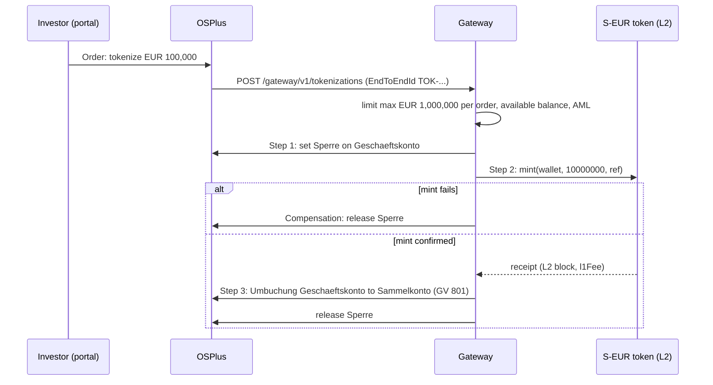
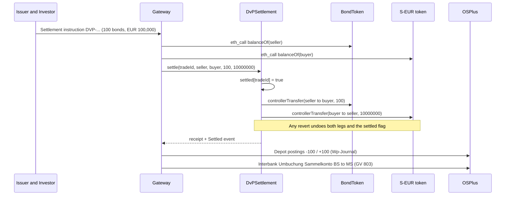
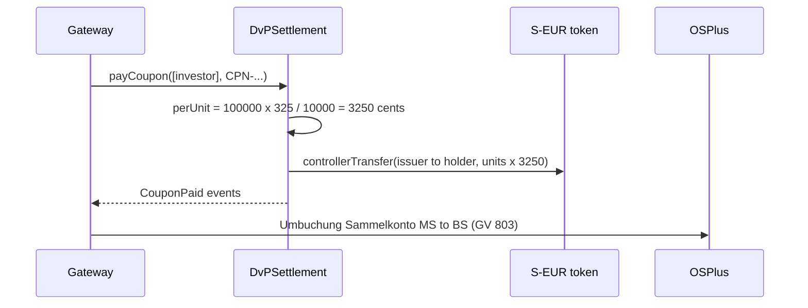
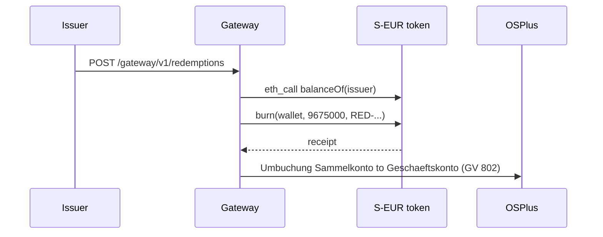

# Business lifecycle

The technical view shows **10 steps**. The executive view groups them into **7 chapters**: *Onboard → Issue bond → Tokenize cash → Settle DvP → Final on RL1 → Pay coupon → Redeem & reconcile*. Steps 5 to 7 are automatic and observed from the chain.

## Steps

| # | Step | Trigger | On-chain call (L2) | OSPlus effect | Live timing |
| - | --- | --- | --- | --- | --- |
| 0 | Bootstrap (first action of a run) | auto | Deploy `TokenizedDeposit`, `BondToken`, `DvPSettlement`, then `setGateway(dvp)` on both tokens (5 txs) | none | ~15 s |
| 1 | Onboard issuer and investor | user | `DvPSettlement.onboard(wallet, ref)` allowlists on both tokens | Client, Geschäftskonto (opening balance, GV 000), Depot | 2–4 s each |
| 2 | Issue 100 bonds (eWpG) | user | `BondToken.issue(issuer, 100, ref)` | Depot +100 (Platzierungsbestand) | 2–4 s |
| 3 | Investor tokenizes €100,000 | user | `TokenizedDeposit.mint(wallet, 10000000, ref)` | Sperre, then Umbuchung Geschäftskonto → Sammelkonto (GV 801), Sperre lifted | 2–4 s |
| 4 | Atomic DvP: 100 bonds ⇄ €100,000 | user | `DvPSettlement.settle(tradeId, seller, buyer, 100, 10000000)` | Depots −100 / +100, interbank Umbuchung Sammelkonto BS → MS (GV 803) | ~2 s |
| 4b | Test: buyer can't pay | user, optional | `settle(...)` with price = buyer's S-EUR + €50,000, reverts | none | ~2 s |
| 5 | L2 data published on RL1 | auto | op-batcher blob tx to the BatchInbox | none | 1–5 min |
| 6 | Final on RL1 | auto | none (RL1 block finality) | "endgültig gebucht" point | at anchoring on a BFT RL1. Sepolia ~13 min later |
| 7 | State proposed in a dispute game | background | `DisputeGameFactory.create()` by op-proposer | none | ~10–30 min, then 3.5 days |
| 8 | Pay 3.25% coupon (€3,250) | user | `DvPSettlement.payCoupon([investor], ref)` | Interbank Umbuchung Sammelkonto MS → BS (GV 803) | 2–4 s |
| 9 | Issuer redeems S-EUR proceeds (€96,750) | user | `TokenizedDeposit.burn(wallet, 9675000, ref)` | Umbuchung Sammelkonto → Geschäftskonto (GV 802) | 2–4 s |
| 10 | Reconcile cash and securities | user | read-only `totalSupply()`, `balanceOf()` | Reconciliation result posted | seconds |

A full live run sends **12 L2 transactions** from the gateway (13 with the failing-trade test): 5 bootstrap, 2 onboard, issue, mint, DvP, coupon, burn. The RL1 batch and dispute-game transactions are sent by OP Sepolia's own operators. The gateway finds and links them.

**Play the full story** (`runLifecycle` in `lib/store.ts`) runs chapters 1 to 4, waits until every tracked transaction is at least *safe* (timeout 60 s in Simulation, 10 min Live), then runs the coupon and the close. It never waits for the dispute game.

## Key flows

### Tokenization saga (hold → mint → book)

The ordering guarantees that no S-EUR exists without euros reserved behind it, and that a failed mint leaves OSPlus untouched.

### Atomic delivery versus payment

The failing-trade test (`Gateway.dvpFailing`) deliberately skips the gateway's pre-checks and sends `settle` with `allowRevert`. The receipt comes back with status 0, and the gateway reads balances before and after to prove nothing moved. On OP Sepolia the reverted transaction is a real, visible transaction.

### Coupon

### Redemption (burn → book)

Redemption mirrors tokenization: tokens are destroyed first, so the bank never pays out euros for tokens that still exist.

## Modelled interfaces

The trace log labels each message with a protocol and endpoint. These are modelled interface names for the architecture discussion. They are not running HTTP services.

| Direction | Protocol | Endpoint / event | Used in |
| --- | --- | --- | --- |
| OSPlus → Gateway | Event (outbox → stream) | `osplus.kunden.v1.KundeAngelegt` | Onboard |
| Client → Gateway | REST | `POST /gateway/v1/issuances`, `/tokenizations`, `/settlements`, `/coupons`, `/redemptions` | Steps 2, 3, 4, 8, 9 |
| Gateway → OSPlus | REST | `POST /osplus/v1/konten/{iban}/sperren` | Tokenize (hold) |
| Gateway → OSPlus | REST | `POST /osplus/v1/umbuchungen` | Tokenize, DvP, coupon, redeem |
| Gateway → OSPlus | REST | `POST /osplus/v1/depots/{depot}/buchungen` | Issue, DvP |
| Gateway → OSPlus | REST | `POST /osplus/v1/abstimmungen` | Reconcile |
| Gateway → L2 | JSON-RPC | `eth_sendRawTransaction`, `eth_getTransactionReceipt`, `eth_call` | All ledger actions |
| L2 → RL1 | RL1 blob tx (EIP-4844) | → `BatchInbox` | Step 5 |
| L2 → RL1 | RL1 tx | `DisputeGameFactory.create()`, later `resolve()` | Step 7 |
