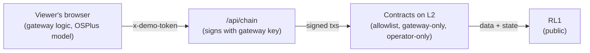

# Security model

## Trust boundaries

Each arrow is a boundary. In the prototype, the only checks between the browser and the key are the optional access token. On-chain, the contracts enforce permissioning independently of who calls the server.

## Assets and controls

| Asset / boundary | Prototype | Production expectation |
| --- | --- | --- |
| Gateway signing key | One environment variable on the server. It is admin, gateway, registrar and DvP operator at the same time | Separate roles (admin multisig, minter, registrar, operator), keys in HSM/KMS, rotation |
| Client keys | Derived from a static seed and the IBAN. They never sign | HSM-held, or no client keys at all (pure custodial accounts) |
| `/api/chain` | Optional shared token. Executes any action it is sent | Gateway business logic and policy server-side, authenticated callers, per-action authorisation, limits, audit log |
| On-chain permissioning | Allowlist on both tokens, gateway-only mint / burn / issue, operator-only DvP, pause switch | Same, plus role separation and on-chain limits |
| Data confidentiality | None. Every L2 transaction is public on OP Sepolia and in blobs on Sepolia | Alt-DA, a privacy layer or hash-only posting |
| Sequencer | Operated by Optimism (OP Sepolia) | Operated by Finanz Informatik or a Verbund entity, permissioned dispute games |
| GitHub Pages build | Static, no key, no server, Simulation only | — |

## Operational hygiene

- Use a **fresh key used only for this demo**. It only ever needs test ETH.
- `.env.local` is git-ignored and never leaves the machine.
- Set `DEMO_ACCESS_TOKEN` on every public deployment with a key.
- The CI and GitHub Pages workflows need no secrets.
