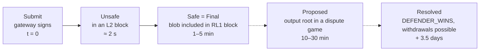

# Settlement & finality

An OP Stack transaction passes through several stages. Only the first two matter for settling a trade. The rest happens in the background.

Solid arrows: the settlement path, which the business process waits for. Dashed arrows: background steps, only needed to withdraw assets from the L2 to RL1.

## Stages

| Stage | Meaning | Source of truth | Gateway action |
| --- | --- | --- | --- |
| Unsafe | The sequencer included the transaction in an L2 block. Fast, but only the sequencer's word | L2 `latest` | Mirror into OSPlus (Depots, Umbuchungen) immediately |
| Safe | op-batcher posted the block's data to RL1. Anyone can re-derive the L2 from RL1 data, and the sequencer can no longer rewrite it silently | L2 `safe` block tag, BatchInbox transaction | Mark as anchored, link the RL1 batch transaction |
| Finalized | The RL1 block holding the batch is final | L2 `finalized` block tag | Mark as "endgültig gebucht" |
| Proposed | op-proposer committed an output root covering the block in a dispute game | DisputeGameFactory | Link the game, count down the challenge window |
| Resolved | Nobody challenged the root during the window. RL1 accepts the state | Game `status()` = `DEFENDER_WINS` | Mark as resolved |

## Why safe and finalized coincide on RL1

RL1 is a **Regulated Layer One**: an EVM chain run by a known set of regulated validators with BFT consensus. Validators agree on each block before it is added, so there are no competing blocks and no reorganisations. A block is irreversible as soon as it exists. Anchoring on RL1 and settlement finality are therefore the same moment.

The live demo uses **Sepolia** (Ethereum proof of stake) as a stand-in. Sepolia finalizes about 64 blocks (~13 minutes) after inclusion, so live you will see *finalized* trail *safe*. The executive KPI "Final on RL1 in" measures anchoring, which equals finality only under the RL1 assumption.

## The dispute game

Separately from the data, op-proposer regularly publishes a fingerprint (output root) of the entire L2 state on RL1 inside a dispute game. For 3.5 days anyone can prove it wrong. If no one does, RL1 accepts it and assets can be withdrawn from the L2 based on that state.

This is what makes the L2 a rollup secured by RL1 rather than a separate chain: even the operator cannot publish a false state without being challenged. But trades on the L2 never wait for it.

## Timings

| Stage | Simulation | OP Sepolia / Sepolia |
| --- | --- | --- |
| Transaction confirmed (unsafe) | ~1 s | ~2 s |
| Anchored on RL1 (safe) | ~5–10 s | usually 1–5 min |
| Final on RL1 | with anchoring | with anchoring on a BFT RL1. Sepolia ~13 min later |
| Dispute game covers the transaction | ~10 s | ~10–30 min |
| Challenge window | 45 s | 3.5 days |

## Shortening time to anchoring

Time to finality is set by RL1's consensus and by how often op-batcher posts (its max channel duration). The `SettlementAnchor` contract (work in progress) offers a way to anchor each settlement on RL1 within one RL1 block, independent of the batcher. See [Smart contracts](smart-contracts.md#settlementanchor-work-in-progress).
