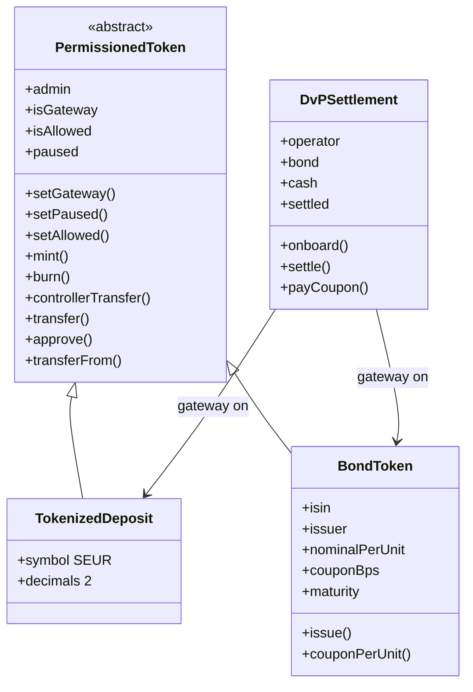

# Smart contracts

Four contracts in use plus one work in progress, all dependency-free so they compile with plain solc. `pnpm compile` (`scripts/compile.ts`) compiles every file in `contracts/` with solc-js (optimizer on, 200 runs, EVM `cancun`) and writes ABIs and bytecode to `lib/chain/artifact.ts`. Neither the app nor Vercel needs Foundry.

## `PermissionedToken` (abstract base)

An ERC-20-shaped token where only allowlisted (KYC/KYB-verified) wallets can hold or move tokens. "Gateways" (the bank's abstraction layer and the DvP contract) mint, burn and execute custodial transfers. Every gateway state change carries a `bytes32` business reference for 1:1 reconciliation.

| Function | Caller | Checks | Events |
| --- | --- | --- | --- |
| `setGateway(addr, enabled)` | admin | — | `GatewaySet` |
| `setPaused(bool)` | admin | — | `Paused` |
| `setAllowed(account, allowed, ref)` | gateway | — | `Allowlisted` |
| `mint(to, value, ref)` | gateway | not paused, `to` allowlisted | `Transfer`, `Minted` |
| `burn(from, value, ref)` | gateway | not paused, balance | `Transfer`, `Burned` |
| `controllerTransfer(from, to, value, ref)` | gateway | not paused, both allowlisted, balance | `Transfer`, `ControllerTransfer` |
| `transfer`, `approve`, `transferFrom` | holder | as above, plus allowance | `Transfer`, `Approval` |

Errors: `NotAdmin`, `NotGateway`, `NotAllowed(address)`, `InsufficientBalance`, `InsufficientAllowance`, `IsPaused`. `admin` is the deployer. The constructor registers one initial gateway.

## `TokenizedDeposit` (S-EUR, cash leg)

"Tokenized Deposit Euro", symbol `S-EUR`, 2 decimals (1 unit = 1 euro cent). A tokenized commercial-bank deposit, backed 1:1 by the OSPlus Sammelkonto of the holder's Sparkasse. No logic beyond the base.

## `BondToken` (securities leg, eWpG register)

The token's balances act as the crypto securities register (Kryptowertpapierregister), kept by the registrar (the gateway). Zero decimals.

Constructor: `(name, symbol, isin, nominalPerUnit, couponBps, maturity, gateway)`. Stored: `isin`, `issuer`, `nominalPerUnit` (cents), `couponBps`, `maturity` (unix seconds).

- `issue(issuer, units, ref)`, gateway only. Sets the issuer on the first issue and reverts with `IssuerMismatch` if another address tries later. Requires the issuer to be allowlisted and the token not paused. Emits `Transfer` and `Issued`.
- `couponPerUnit()` = `nominalPerUnit × couponBps / 10,000` = 100,000 × 325 / 10,000 = **3,250 cents**.

## `DvPSettlement`

Registered as a gateway on both tokens during bootstrap. Only the `operator` (the bank's gateway key) can instruct it. `bond` and `cash` are immutable.

| Function | Effect | Guarantee |
| --- | --- | --- |
| `onboard(account, ref)` | Allowlists the account on the bond register and on S-EUR in one transaction | Both or neither |
| `settle(tradeId, seller, buyer, units, price)` | Marks `settled[tradeId]`, delivers bonds seller → buyer, pays S-EUR buyer → seller | Atomic. Replay-protected by `AlreadySettled` |
| `payCoupon(holders[], ref)` | For each holder, skipping the issuer and empty positions, pays `units × couponPerUnit` from the issuer's S-EUR | All holders or none. Computed from the register |

Events: `Onboarded`, `Settled`, `CouponPaid`. Errors: `NotOperator`, `AlreadySettled(bytes32)`.

## `SettlementAnchor` (work in progress)

Meant to be deployed on RL1. Right after an L2 settlement, the gateway would record `l2TxHash → (l2Block, l2BlockHash, ref, anchoredAt)` with `anchor()` (operator only, once per transaction). This gives every settlement its own RL1 record within one RL1 block, independent of the batcher's cadence. On a BFT RL1 that record is final at inclusion.

The contract is compiled into `artifact.ts` but not yet used by `live-server.ts`.

## Who can call what

| Address | Role on S-EUR / BondToken | Role on DvPSettlement |
| --- | --- | --- |
| Gateway key (`GATEWAY_PRIVATE_KEY`) | admin (deployer) and gateway: mint, burn, issue, allowlist, controllerTransfer, pause | operator: onboard, settle, payCoupon |
| `DvPSettlement` contract | gateway (via `setGateway` at bootstrap) | — |
| Client wallets (custody-derived) | allowlisted holders. Could call `transfer` if their key signed, which never happens in the demo | — |

## Deployment per run

Each demo run (and each **Start over**) deploys a fresh set: S-EUR, the bond register, the DvP contract, then authorises the DvP contract on both tokens. OSPlus is simulated and starts empty on every run, so the on-chain ledgers must start empty too, and the reconciliation compares like with like.
